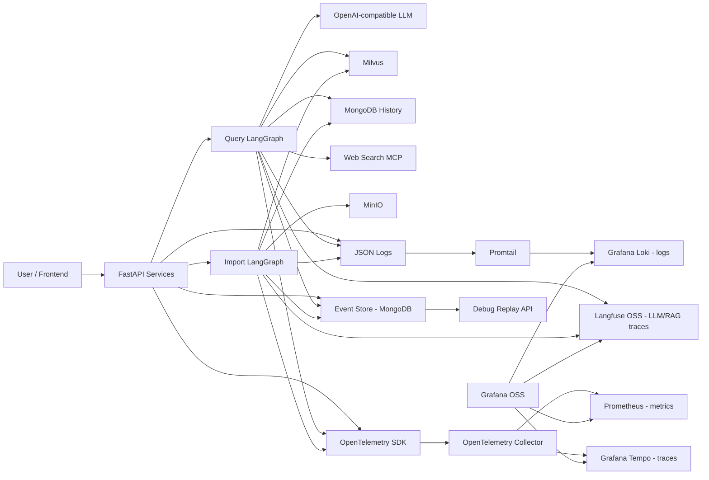

# kbase-rag 可观测体系设计方案

## 1. 背景和目标

本项目是一个基于 FastAPI + LangGraph 的 RAG 系统，包含两条核心链路：

- 查询链路：用户提问 -> 商品识别 -> 向量检索 / HyDE / Web 搜索 -> RRF -> Rerank -> LLM 生成 -> SSE/HTTP 返回。
- 导入链路：文件上传 -> PDF/Markdown 解析 -> 图片处理 -> 文档切分 -> 商品识别 -> Embedding -> Milvus 入库。

当前项目已经具备一些可观测基础：

- `app/core/logger.py`：基于 Loguru 的统一日志。
- `app/core/tracing.py`：OpenTelemetry 初始化代码已有雏形，但整体被注释。
- `app/clients/langfuse.py`：已接入 Langfuse。
- `app/query_process/agent/nodes/*`：部分函数已使用 `@observe`。
- `app/utils/task_utils.py` 和 `app/utils/sse_utils.py`：已有任务状态和进度事件。

目标是在不破坏现有业务逻辑的基础上，建设覆盖 `trace`、`log`、`metric`、`event` 的全链路可观测体系，并支持：

- 单次请求从 API 到 LangGraph 节点、外部依赖、LLM 调用的完整追踪。
- 按 `trace_id`、`session_id`、`task_id` 关联日志、指标、事件和 LLM 详情。
- 查询和导入链路的性能、错误率、依赖健康、模型调用成本可视化。
- 通过事件流和节点快照支持调试回放、故障诊断和单节点重放。
- 全部组件使用开源框架和自托管部署。

## 2. 选型原则

1. 使用 OpenTelemetry 作为统一采集标准，避免绑定单一厂商。
2. 使用 Grafana OSS 体系承载通用 trace/log/metric 观测。
3. 使用 Langfuse OSS 承载 LLM/RAG 专项观测。
4. 使用项目已有 MongoDB 作为第一阶段事件存储，降低落地成本。
5. 保留当前内存态 `task_utils.py` 和 SSE 机制，但事件事实必须持久化。
6. 所有敏感内容默认脱敏或引用化，避免 prompt、answer、文档 chunk 全量进入日志。

## 3. 总体架构



## 4. 开源组件清单

| 能力 | 组件 | 用途 |
| --- | --- | --- |
| Trace 标准 | OpenTelemetry Python SDK | 业务 span、依赖 span、上下文传播 |
| Trace 采集 | OpenTelemetry Collector | 接收 OTLP，统一处理和转发 |
| Trace 存储 | Grafana Tempo | 存储和查询分布式链路 |
| Log 采集 | Loguru JSON + Promtail | 应用日志结构化采集 |
| Log 存储 | Grafana Loki | 按标签和 trace_id 查询日志 |
| Metric 存储 | Prometheus | 指标存储、PromQL、告警输入 |
| 可视化 | Grafana OSS | Dashboard、Trace/Log/Metric 关联 |
| 告警 | Alertmanager | 告警路由和通知 |
| LLM 观测 | Langfuse OSS | Prompt、Generation、Token、RAG Trace |
| Event 存储 | MongoDB | 持久化业务事件和回放快照索引 |
| 对象存储 | MinIO | 大输入/输出快照、文档片段、回放附件 |

第一阶段可以直接复用项目已有 MongoDB、MinIO、Langfuse。Tempo、Loki、Prometheus、Grafana、OpenTelemetry Collector 通过 Docker Compose 部署。

## 5. 统一关联字段

所有 trace、log、metric、event 必须尽量携带以下字段。

| 字段 | 示例 | 说明 |
| --- | --- | --- |
| `trace_id` | `6d4...` | OpenTelemetry trace id |
| `span_id` | `a91...` | 当前 span id |
| `session_id` | 查询会话 UUID | 查询链路主关联键 |
| `task_id` | 导入任务 UUID | 导入链路主关联键 |
| `request_id` | HTTP 请求 UUID | API 请求关联键 |
| `graph` | `query` / `import` | 所属业务图 |
| `node_name` | `node_rerank` | LangGraph 节点名 |
| `user_id` | `query_user_1` | 用户维度，后续可接认证体系 |
| `model` | `qwen3-32b` | LLM / embedding / reranker 模型 |
| `collection_name` | Milvus collection | 向量库集合 |
| `status` | `ok` / `error` | 执行结果 |
| `error_type` | `TimeoutError` | 异常类型 |

## 6. Trace 设计

### 6.1 Span 层级

查询链路 span 建议如下：

```text
HTTP POST /query
└── workflow.query
    ├── node.node_item_name_confirm
    │   ├── llm.rewrite_query
    │   ├── embedding.item_name
    │   └── milvus.search.item_name
    ├── node.node_search_embedding
    │   ├── embedding.query
    │   └── milvus.search.chunks
    ├── node.node_search_embedding_hyde
    │   ├── llm.hyde
    │   ├── embedding.hyde
    │   └── milvus.search.chunks
    ├── node.node_web_search_mcp
    ├── node.node_rrf
    ├── node.node_rerank
    │   └── reranker.compute_score
    └── node.node_answer_output
        └── llm.answer
```

导入链路 span 建议如下：

```text
HTTP POST /upload
└── workflow.import
    ├── file.save
    ├── node.node_entry
    ├── node.node_pdf_to_md
    ├── node.node_md_img
    ├── node.node_document_split
    ├── node.node_item_name_recognition
    │   └── llm.item_name_recognition
    ├── node.node_bge_embedding
    │   └── embedding.batch
    └── node.node_import_milvus
        └── milvus.insert
```

### 6.2 需要改造的文件

| 文件 | 改造内容 |
| --- | --- |
| `app/core/tracing.py` | 恢复并完善 OTel 初始化，支持 OTLP traces/metrics |
| `app/query_process/api/query__server.py` | 在任何 `app.*` import 前初始化 tracing，FastAPI instrumentation |
| `app/import_process/api/import_server.py` | 同上 |
| `app/query_process/agent/main_graph.py` | 用观测包装器包裹每个 node |
| `app/import_process/agent/main_graph.py` | 用观测包装器包裹每个 node |
| `app/lm/lm_utils.py` | LLM 初始化和调用维度补充 span attributes |
| `app/lm/embedding_utils.py` | embedding 生成耗时、批量大小、模型信息 |
| `app/lm/reranker_utils.py` | reranker 模型加载、打分耗时 |
| `app/clients/milvus_utils.py` | Milvus 连接、search、insert、query span |
| `app/clients/mongo_history_utils.py` | MongoDB 历史读写 span |
| `app/utils/sse_utils.py` | SSE 连接、发送、断开事件 span/log |

### 6.3 新增模块

```text
app/observability/
├── __init__.py
├── context.py          # request_id/session_id/task_id/node_name 上下文变量
├── tracing.py          # span 工具函数
├── metrics.py          # 指标定义和记录函数
├── events.py           # 业务事件模型和写入
├── snapshots.py        # 大对象快照保存和读取
├── decorators.py       # node/span/event 包装器
└── sanitizers.py       # 脱敏、摘要、hash、截断
```

## 7. Log 设计

### 7.1 日志格式

当前 `app/core/logger.py` 使用可读文本格式。生产可观测需要新增 JSON sink。

建议日志字段：

```json
{
  "ts": "2026-07-17T12:00:00.123+08:00",
  "level": "INFO",
  "message": "node completed",
  "logger": "node_rerank.py",
  "function": "node_rerank",
  "line": 154,
  "trace_id": "...",
  "span_id": "...",
  "request_id": "...",
  "session_id": "...",
  "task_id": "...",
  "graph": "query",
  "node_name": "node_rerank",
  "event_type": "node.completed",
  "duration_ms": 356.2,
  "status": "ok"
}
```

### 7.2 日志内容规范

禁止直接记录：

- 完整 prompt。
- 完整 answer。
- 完整 `state`。
- 完整文档 chunk 内容。
- API key、数据库密码、OTLP headers。

允许记录：

- 文本长度：`prompt_chars`、`answer_chars`。
- 内容 hash：`prompt_sha256`、`answer_sha256`。
- 摘要：前 200 字，且经过脱敏。
- 检索结果 ID：`chunk_ids`、`source_count`。
- 评分范围：`max_score`、`min_score`、`top_k`。

## 8. Metric 设计

### 8.1 API 指标

| 指标 | 类型 | 标签 |
| --- | --- | --- |
| `rag_http_requests_total` | Counter | `route`, `method`, `status_code` |
| `rag_http_request_duration_seconds` | Histogram | `route`, `method` |
| `rag_sse_connections` | UpDownCounter/Gauge | `status` |
| `rag_sse_events_total` | Counter | `event` |

### 8.2 查询链路指标

| 指标 | 类型 | 标签 |
| --- | --- | --- |
| `rag_query_total` | Counter | `status`, `is_stream` |
| `rag_query_duration_seconds` | Histogram | `status`, `is_stream` |
| `rag_node_duration_seconds` | Histogram | `graph`, `node_name`, `status` |
| `rag_retrieval_docs_total` | Histogram | `source` |
| `rag_rerank_input_docs_total` | Histogram | 无 |
| `rag_rerank_output_docs_total` | Histogram | 无 |
| `rag_answer_chars_total` | Histogram | `is_stream` |

### 8.3 导入链路指标

| 指标 | 类型 | 标签 |
| --- | --- | --- |
| `rag_import_total` | Counter | `status`, `file_type` |
| `rag_import_duration_seconds` | Histogram | `status`, `file_type` |
| `rag_import_chunks_total` | Histogram | `splitter` |
| `rag_import_embeddings_total` | Counter | `model` |
| `rag_import_file_bytes` | Histogram | `file_type` |

### 8.4 模型和依赖指标

| 指标 | 类型 | 标签 |
| --- | --- | --- |
| `rag_llm_requests_total` | Counter | `model`, `status`, `json_mode` |
| `rag_llm_duration_seconds` | Histogram | `model`, `json_mode`, `status` |
| `rag_llm_tokens_total` | Counter | `model`, `type=prompt|completion|total` |
| `rag_embedding_duration_seconds` | Histogram | `model`, `device`, `status` |
| `rag_embedding_batch_size` | Histogram | `model` |
| `rag_milvus_operations_total` | Counter | `operation`, `collection`, `status` |
| `rag_milvus_operation_duration_seconds` | Histogram | `operation`, `collection`, `status` |
| `rag_mongo_operations_total` | Counter | `operation`, `collection`, `status` |
| `rag_circuit_state` | Gauge | `name`, `state` |
| `rag_consecutive_failures` | Gauge | `name` |

## 9. Event 设计

Trace 解决“调用链”，Log 解决“文本上下文”，Metric 解决“聚合趋势”。调试回放需要可持久化、可排序、业务语义明确的 Event。

### 9.1 Event 数据模型

MongoDB collection：`observability_events`

```json
{
  "_id": "uuid",
  "ts": "2026-07-17T12:00:00.123+08:00",
  "trace_id": "string",
  "span_id": "string",
  "request_id": "string",
  "session_id": "string",
  "task_id": "string",
  "graph": "query",
  "node_name": "node_rerank",
  "event_type": "node.completed",
  "sequence": 12,
  "status": "ok",
  "duration_ms": 356.2,
  "input_ref": "minio://observability-snapshots/...",
  "output_ref": "minio://observability-snapshots/...",
  "summary": {
    "input_keys": ["rrf_chunks", "web_search_docs"],
    "rrf_chunks_count": 5,
    "web_docs_count": 3,
    "reranked_docs_count": 4,
    "top_score": 0.92
  },
  "error": {
    "type": null,
    "message": null,
    "stack_ref": null
  },
  "tags": ["query", "rerank"]
}
```

### 9.2 Event 类型

查询链路：

- `query.received`
- `query.accepted`
- `workflow.started`
- `node.started`
- `llm.started`
- `llm.completed`
- `embedding.completed`
- `retrieval.completed`
- `rrf.completed`
- `rerank.completed`
- `answer.started`
- `answer.delta`
- `answer.completed`
- `sse.sent`
- `workflow.completed`
- `workflow.failed`

导入链路：

- `import.upload.received`
- `import.file.saved`
- `workflow.started`
- `node.started`
- `pdf.converted`
- `markdown.images.extracted`
- `document.chunked`
- `item_name.recognized`
- `embedding.completed`
- `milvus.inserted`
- `workflow.completed`
- `workflow.failed`

### 9.3 索引设计

```javascript
db.observability_events.createIndex({ session_id: 1, ts: 1 })
db.observability_events.createIndex({ task_id: 1, ts: 1 })
db.observability_events.createIndex({ trace_id: 1, ts: 1 })
db.observability_events.createIndex({ event_type: 1, ts: -1 })
db.observability_events.createIndex({ graph: 1, node_name: 1, ts: -1 })
```

## 10. 快照和回放设计

### 10.1 为什么需要快照

日志不能记录完整 state，trace 也不适合保存大对象。调试回放需要知道节点输入和输出，因此需要将大对象快照保存到 MinIO，只在 Event 中保存引用。

### 10.2 快照策略

| 内容 | 保存策略 |
| --- | --- |
| 原始 query | Event summary 保存脱敏文本，完整文本可加密保存 |
| prompt | 默认只保存 hash 和长度；调试环境可保存完整快照 |
| answer | 保存 hash、长度、前 200 字摘要；调试环境可保存完整 |
| chunks | 保存 `chunk_id/title/source/score`，不保存全文 |
| node input state | 按白名单字段保存 |
| node output state | 按白名单字段保存 |
| exception traceback | 保存到 MinIO，event 中放 `stack_ref` |

### 10.3 回放 API

新增文件：`app/observability/api/debug_server.py` 或并入现有查询服务。

接口：

```text
GET /debug/sessions/{session_id}/timeline
GET /debug/tasks/{task_id}/timeline
GET /debug/traces/{trace_id}/timeline
GET /debug/events/{event_id}
GET /debug/snapshots/{snapshot_id}
POST /debug/replay/query/{session_id}
POST /debug/replay/import/{task_id}
POST /debug/replay/node
```

`POST /debug/replay/node` 请求体：

```json
{
  "event_id": "node.started event id",
  "mode": "mock_external",
  "from_node": "node_rerank",
  "override_state": {}
}
```

回放模式：

| 模式 | 说明 |
| --- | --- |
| `timeline_only` | 只展示事件时间线，不重跑 |
| `mock_external` | 使用历史 LLM/Web/Milvus 响应，不调用外部依赖 |
| `live_external` | 重新调用外部依赖，用于验证线上修复 |
| `from_node` | 从指定节点输入快照开始重跑 |

第一阶段只实现 `timeline_only`。第二阶段实现 `mock_external`。第三阶段实现 `from_node`。

## 11. 代码落地方案

### 11.1 恢复 tracing 初始化

目标文件：`app/core/tracing.py`

实现能力：

- 幂等初始化。
- 读取 `.env`。
- 配置 `service.name`、`service.version`、`deployment.environment`。
- OTLP HTTP exporter。
- FastAPI 自动 instrumentation。
- requests/httpx/pymongo 自动 instrumentation。
- 控制台 exporter 仅调试环境打开。

环境变量：

```env
OTEL_SERVICE_NAME=kbase-rag
OTEL_SERVICE_VERSION=0.1.0
OTEL_ENVIRONMENT=dev
OTEL_EXPORTER_OTLP_ENDPOINT=http://localhost:4318
OTEL_EXPORTER_OTLP_PROTOCOL=http/protobuf
OTEL_TRACES_SAMPLER=parentbased_traceidratio
OTEL_TRACES_SAMPLER_ARG=1.0
OTEL_CONSOLE_EXPORTER=false
```

注意：`setup_tracing()` 必须在 `app.*` 业务模块 import 之前执行。

### 11.2 LangGraph 节点包装器

新增：`app/observability/decorators.py`

设计：

```python
def observe_node(graph: str, node_name: str, fn: Callable) -> Callable:
    def wrapper(state):
        # 1. 设置 context vars
        # 2. 写 node.started event
        # 3. start span: node.{node_name}
        # 4. 记录 node duration metric
        # 5. 成功写 node.completed event
        # 6. 异常写 node.failed event，并记录 exception
        return fn(state)
    return wrapper
```

在 `main_graph.py` 注册节点时使用：

```python
builder.add_node(
    "node_rerank",
    observe_node("query", "node_rerank", node_rerank)
)
```

这样不用在每个节点里重复写 span/event 逻辑，也不会破坏现有节点函数。

### 11.3 事件写入

新增：`app/observability/events.py`

核心函数：

```python
emit_event(
    event_type: str,
    graph: str,
    node_name: str | None = None,
    session_id: str | None = None,
    task_id: str | None = None,
    status: str = "ok",
    summary: dict | None = None,
    input_ref: str | None = None,
    output_ref: str | None = None,
    error: dict | None = None,
)
```

实现要求：

- 从当前 OTel span 自动读取 `trace_id/span_id`。
- 从 context vars 自动读取 `request_id/session_id/task_id/node_name`。
- 失败时不能影响主流程，只记录 warning。
- MongoDB 不可用时降级到本地 JSONL 文件，避免事件完全丢失。

### 11.4 日志注入 trace 上下文

目标文件：`app/core/logger.py`

实现：

- patch record 时读取当前 span。
- 注入 `trace_id`、`span_id`。
- 注入 context vars：`request_id/session_id/task_id/graph/node_name`。
- 新增 JSON 文件 sink：`logs/app_{time:YYYYMMDD}.jsonl`。

### 11.5 指标定义

新增：`app/observability/metrics.py`

设计：

- 使用 OpenTelemetry Metrics API。
- 所有业务代码通过封装函数记录，不直接操作 instrument。
- 示例函数：

```python
record_node_duration(graph, node_name, status, duration_seconds)
record_query(status, is_stream, duration_seconds)
record_llm_call(model, status, duration_seconds, prompt_tokens=None, completion_tokens=None)
record_milvus_operation(operation, collection, status, duration_seconds)
```

### 11.6 SSE 和任务事件统一

目标文件：

- `app/utils/task_utils.py`
- `app/utils/sse_utils.py`

改造：

- `update_task_status()` 写 `task.status_changed` event。
- `add_running_task()` 写 `node.running` event。
- `add_done_task()` 写 `node.done` event。
- `push_to_session()` 写 `sse.sent` event 和 `rag_sse_events_total` metric。

注意：现有内存状态继续保留，用于页面即时展示；Mongo event store 成为事实来源。

## 12. 部署方案

新增目录：

```text
deploy/observability/
├── docker-compose.yml
├── otel-collector-config.yaml
├── promtail-config.yaml
├── prometheus.yml
├── loki-config.yaml
├── tempo-config.yaml
└── grafana/
    ├── datasources.yml
    └── dashboards/
```

### 12.1 OpenTelemetry Collector

`otel-collector-config.yaml`：

```yaml
receivers:
  otlp:
    protocols:
      http:
        endpoint: 0.0.0.0:4318
      grpc:
        endpoint: 0.0.0.0:4317

processors:
  batch:
  memory_limiter:
    check_interval: 1s
    limit_mib: 512

exporters:
  otlp/tempo:
    endpoint: tempo:4317
    tls:
      insecure: true
  prometheus:
    endpoint: 0.0.0.0:8889
  logging:
    verbosity: basic

service:
  pipelines:
    traces:
      receivers: [otlp]
      processors: [memory_limiter, batch]
      exporters: [otlp/tempo]
    metrics:
      receivers: [otlp]
      processors: [memory_limiter, batch]
      exporters: [prometheus]
```

### 12.2 Prometheus

`prometheus.yml`：

```yaml
global:
  scrape_interval: 15s

scrape_configs:
  - job_name: otel-collector
    static_configs:
      - targets: ["otel-collector:8889"]
```

### 12.3 Promtail

`promtail-config.yaml`：

```yaml
server:
  http_listen_port: 9080
  grpc_listen_port: 0

positions:
  filename: /tmp/positions.yaml

clients:
  - url: http://loki:3100/loki/api/v1/push

scrape_configs:
  - job_name: kbase-rag
    static_configs:
      - targets: [localhost]
        labels:
          job: kbase-rag
          service_name: kbase-rag
          __path__: /app/logs/*.jsonl
```

## 13. Dashboard 设计

### 13.1 总览 Dashboard

面板：

- QPS。
- 查询成功率 / 失败率。
- P50/P95/P99 查询耗时。
- 导入成功率 / 失败率。
- LLM 请求数、错误率、平均耗时。
- Milvus 请求数、错误率、P95 耗时。
- 当前熔断状态。
- SSE 在线连接数。

### 13.2 查询链路 Dashboard

面板：

- 各 LangGraph 节点耗时分布。
- 检索召回数量：embedding、hyde、web、rrf、rerank。
- Rerank 输入/输出数量。
- LLM prompt/completion token 趋势。
- Top 错误节点。
- 慢查询 trace 列表。

### 13.3 导入链路 Dashboard

面板：

- 文件上传数量和大小。
- PDF 转 MD 耗时。
- 文档切块数量分布。
- Embedding batch 耗时。
- Milvus 入库耗时和失败率。
- 失败任务列表。

### 13.4 调试 Dashboard

面板：

- 按 `session_id` 搜索 timeline。
- 按 `task_id` 搜索 timeline。
- trace/log/event 三联跳转。
- LLM generation 链接到 Langfuse。

## 14. 告警规则

第一阶段告警：

| 告警 | 条件 | 级别 |
| --- | --- | --- |
| 查询错误率过高 | 5 分钟错误率 > 5% | warning |
| 查询 P95 过高 | 5 分钟 P95 > 15s | warning |
| LLM 错误率过高 | 5 分钟错误率 > 10% | critical |
| Milvus 慢查询 | P95 > 2s 持续 10 分钟 | warning |
| 导入失败率过高 | 15 分钟失败率 > 10% | warning |
| 熔断打开 | `rag_circuit_state{state="open"} == 1` | critical |
| 事件写入失败 | event write failure > 0 | warning |
| SSE 异常断连激增 | 5 分钟断连数超过基线 3 倍 | warning |

## 15. 分阶段实施计划

### 第一阶段：基础可观测闭环，预计 3-5 天

目标：能从一次请求跳到 trace、log、metric。

任务：

1. 恢复 `app/core/tracing.py`。
2. 两个 FastAPI 服务最早调用 `setup_tracing()`。
3. 新增 `app/observability/context.py`。
4. 改造 `app/core/logger.py`，注入 trace_id/span_id 和 JSON sink。
5. 新增 `app/observability/decorators.py`，包装 LangGraph 节点。
6. 新增 `app/observability/metrics.py`，记录 API、节点、LLM、Milvus 基础指标。
7. 新增 `deploy/observability`，部署 Collector、Tempo、Prometheus、Loki、Grafana。
8. 建 Grafana datasource。

验收：

- 调用 `/query` 后 Grafana Tempo 能看到完整 trace。
- Loki 能用同一个 `trace_id` 查到日志。
- Prometheus 能查到 `rag_query_total` 和 `rag_node_duration_seconds`。
- 节点异常时 trace、log、metric 均能看到失败信息。

### 第二阶段：事件持久化和 timeline，预计 3-5 天

目标：支持按 session/task 回看完整业务过程。

任务：

1. 新增 `app/observability/events.py`。
2. MongoDB 新增 `observability_events` collection 和索引。
3. 在 API、节点包装器、SSE、任务状态中写 event。
4. 新增 debug timeline API。
5. 对事件 summary 做脱敏、截断、hash。
6. Grafana 或简单 HTML 页面展示 timeline。

验收：

- `/debug/sessions/{session_id}/timeline` 返回查询全过程。
- `/debug/tasks/{task_id}/timeline` 返回导入全过程。
- 即使 SSE 客户端断开，事件仍可回看。
- 事件写入失败不影响主流程。

### 第三阶段：快照和回放，预计 5-8 天

目标：支持故障复现和节点级调试。

任务：

1. 新增 `app/observability/snapshots.py`。
2. MinIO 新增 bucket：`observability-snapshots`。
3. 节点包装器按白名单保存 input/output 快照。
4. LLM/Web/Milvus 外部响应支持 mock 读取。
5. 实现 `POST /debug/replay/node` 的 `mock_external` 模式。
6. 实现从指定节点输入快照开始重跑。

验收：

- 可以从失败的 `node_rerank` 输入快照重放。
- 可以不调用真实 LLM，使用历史 LLM 响应回放。
- 回放产生新的 `replay_trace_id`，并关联原始 `trace_id`。

### 第四阶段：质量和成本观测，预计 5-10 天

目标：从系统可用性扩展到 RAG 效果和模型成本。

任务：

1. Langfuse dataset/evaluation 接入。
2. 记录 answer 是否有引用、引用 chunk 数、图片返回数量。
3. 记录用户反馈或人工评分。
4. 计算 query 改写成功率、无商品命中率、召回为空率。
5. 建立 RAG 质量 Dashboard。

验收：

- 可以按商品、模型、节点查看回答质量趋势。
- 可以对某批 session 做离线评估。
- 可以定位“召回失败”“重排失败”“生成失败”的具体比例。

## 16. 首批代码改造顺序

建议按以下 PR/提交顺序拆分，降低风险：

1. `observability-bootstrap`
   - 恢复 tracing。
   - 增加 context vars。
   - FastAPI 初始化 OTel。

2. `observability-logs`
   - logger 注入 trace context。
   - JSONL 日志。
   - Promtail 配置。

3. `observability-node-spans`
   - LangGraph node wrapper。
   - 节点 span 和基础 metric。

4. `observability-events`
   - Mongo event store。
   - SSE/task event 接入。
   - timeline API。

5. `observability-replay`
   - snapshot。
   - replay API。
   - mock external dependencies。

## 17. 风险和处理

| 风险 | 处理 |
| --- | --- |
| OTel 初始化太晚导致 span 丢失 | 在 API server 文件最顶部、所有 `app.*` import 前调用 |
| 日志量暴涨 | JSON 日志只记摘要，chunk/prompt/answer 不全量落日志 |
| 高基数字段拖垮指标 | `session_id/task_id/trace_id` 不进入 metric label |
| 事件写入影响主流程 | event write 必须 best-effort，失败只 warning |
| Langfuse 和 OTel 重复观测 | OTel 做系统链路，Langfuse 做 LLM/RAG 详情，两者用 session_id/trace_id 关联 |
| 回放误调用真实外部服务 | 默认 `mock_external`，`live_external` 必须显式声明 |
| 敏感数据泄漏 | `sanitizers.py` 统一脱敏，调试环境和生产环境采用不同快照策略 |

## 18. 完成后的诊断流程

### 18.1 查询慢

1. Grafana 查询 `rag_query_duration_seconds` P95。
2. 点开慢请求 trace。
3. 查看哪个 node 耗时高。
4. 如果是 Milvus，查看 `rag_milvus_operation_duration_seconds` 和对应 collection。
5. 如果是 LLM，跳转 Langfuse 查看 prompt/token/model。
6. 用 `session_id` 打开 timeline，确认事件顺序和输入输出摘要。

### 18.2 查询失败

1. 根据告警拿到 `trace_id` 或 `session_id`。
2. Tempo 看失败 span 和 exception。
3. Loki 用 `trace_id` 查询关联日志。
4. Timeline 查看失败前最后一个业务事件。
5. 如果需要复现，使用失败节点的 input snapshot 进行 `mock_external` 回放。

### 18.3 回答质量差

1. Langfuse 查看 prompt、generation 和模型输出。
2. Timeline 查看召回数量、RRF 数量、rerank topK。
3. 检查是否商品识别失败、召回为空、rerank 分数断崖、prompt 超长截断。
4. 从 `node_answer_output` 或 `node_rerank` 开始回放，验证修复。

## 19. 最小可交付范围

如果需要最快落地，MVP 只做以下内容：

1. OTel trace：API + workflow + node。
2. JSON log：带 `trace_id/session_id/task_id/node_name`。
3. Metrics：请求数、耗时、失败数、节点耗时、LLM/Milvus 耗时。
4. Events：`workflow.started/completed/failed`、`node.started/completed/failed`、`sse.sent`。
5. Timeline API：按 `session_id/task_id` 返回事件列表。
6. Grafana：Tempo + Loki + Prometheus 三个数据源和一张总览 Dashboard。

完成 MVP 后，项目就具备基本的故障定位能力；后续再做快照和回放，把它升级为可复现、可调试的工程体系。
